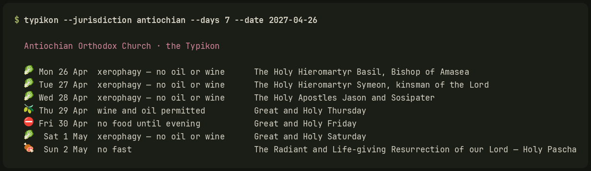

# typikon

The Orthodox liturgical day: feasts, seasons and the fast, computed rather
than fetched.

Everything derives from the paschalion and the fixed calendar, so it needs no
network, cannot go stale, and answers for any year you ask about. No API key,
no service that might be gone next year, no cache to invalidate.



```console
$ typikon
  Wednesday 18 March 2026   — 5 March in the church calendar
  Russian Orthodox Church Outside Russia · the Typikon

  🥬  The Holy Martyr Conon

      xerophagy — no oil or wine
      a weekday of the Great Fast
      Great Fast
```

## Install

```console
$ pipx install git+https://git.pumpin.online/funkpower/typikon
```

Or run it straight out of a checkout. It has no dependencies and needs only
Python 3.9.

```console
$ git clone https://git.pumpin.online/funkpower/typikon
$ cd typikon && python -m typikon.cli
```

## Which calendar?

Three things get conflated constantly, and keeping them apart is most of what
this library is for:

| | |
|---|---|
| **Paschalion** | which table gives Pascha, Julian or Gregorian |
| **Menologion** | which calendar the fixed feasts are read on |
| **Rule** | which fasting discipline is kept |

Almost every Orthodox Church keeps the **Julian Paschalion**. What divides them
is the menologion. The old-calendar churches read the fixed feasts on the
Julian calendar too; the new-calendar churches read them on the Revised Julian,
which agrees with the Gregorian for every date until 2800. So a new-calendar
church keeps the Nativity with the West and Pascha with the East, not a
compromise but exactly what the 1923 congress decided.

Pick a reckoning without naming a church:

```console
$ typikon --calendar old        # Julian throughout
$ typikon --calendar new        # Revised Julian fixed feasts, Julian Pascha
$ typikon --calendar western    # Gregorian throughout
```

Or name one, which also picks up its fasting rule and any local saints:

```console
$ typikon --jurisdiction rocor
$ typikon --jurisdiction antiochian --days 7
$ typikon --list                # every accepted value
```

The first run writes your choice to `~/.config/typikon/config.toml` and stops
asking. Change it with `--set-default`, override it for one run with the flag,
or set `TYPIKON_JURISDICTION`.

Twenty-three jurisdictions ship: the old-calendar churches (Moscow, ROCOR,
Serbia, Georgia, Jerusalem, the Holy Mountain, Poland, Macedonia), the
new-calendar ones (Constantinople, Greece, GOARCH, Antioch, the OCA, Romania,
Bulgaria, Cyprus, Albania, Ukraine), the Finnish Orthodox Church, alone among
the Orthodox in keeping the Gregorian Paschalion, and, as an add-on, four
Byzantine Catholic churches.

## The fast

Six levels, ordered from strictest to laxest. They are the Typikon's own
distinctions, not a simplification of them:

| | |
|---|---|
| `strict` | no food until evening |
| `xerophagy` | no oil, no wine; no meat, fish, eggs or dairy |
| `wine_oil` | wine and oil permitted |
| `fish` | fish, wine and oil permitted |
| `dairy` | dairy, eggs and fish permitted; no meat |
| `none` | no fast |

A calendar that reports xerophagy and wine-and-oil both as "fasting" has thrown
away the information its reader wanted.

**Level and obligation are separate questions.** The Orthodox Church legislates
fasting as tradition rather than as precept, so every Orthodox day here reports
as customary. The Eastern Catholic churches do have law about it, and it
requires very much less than the Typikon describes, so those jurisdictions
report both the level at which the day is kept and the minimum that actually
binds. A calendar saying "obligatory" where nothing obliges is worse than no
calendar; one reporting only the binding minimum makes the obligatory days look
laxer than the voluntary ones beside them.

Where usages differ (Great Thursday, the Exaltation, Lazarus Saturday), this
follows the common published rule and names it in the day's reason so you can
disagree with it. Monastic practice, and the Holy Mountain in particular, is
stricter than all of it. A calendar cannot settle that; your bishop and your
spiritual father can.

## Output

```console
$ typikon --json --days 7        # for a bar, a widget, a script
$ typikon --ics --days 365 > orthodox.ics
$ typikon --year 2027            # a year's key dates, to check against yours
```

The JSON shape is flat and stable. Front ends are the thing most likely to be
written by someone else, and a schema that shifts underneath them is a bad
neighbour.

## As a library

```python
import typikon

d = typikon.today("rocor")
d.church_date      # '5 September'
d.fast             # 'xerophagy'
d.title            # 'The Holy Prophet Zachariah, father of the Forerunner'
d.is_obligatory    # False

typikon.julian_pascha(2027)      # datetime.date(2027, 5, 2)
typikon.gregorian_pascha(2027)   # datetime.date(2027, 3, 28)

for day in typikon.week(date, 7, "antiochian"):
    ...
```

## The menologion

The fixed calendar ships as data and is indexed by **ecclesiastical** date, so
one file serves every jurisdiction. An old-calendar church and a new-calendar
church both keep the Nativity on 25 December; they disagree about which morning
that is, and that disagreement lives in the calendar conversion, not in the
data.

`typikon/data/menologion.json` covers all 366 days with the principal
commemorations of the common Byzantine tradition, ranked so the fasting rules
know when a feast lifts a Wednesday. It was composed for this project and is
under the same licence as the code. It is a working set, not a complete
Synaxarion; additions are welcome.

Some churches also keep their own saints, and those lists are usually published
by a body that holds the copyright in the wording. Those are **not** shipped.
Fetch one onto your own machine instead:

```console
$ typikon --list-menaia
$ typikon --update-menaion ruthenian
```

It lands beside the packaged menologion and is overlaid automatically.

## Accuracy

`typikon` is pinned by 60 tests against published calendars: the paschalion
for six years by both reckonings, the Julian drift across the 2100 boundary,
the fast on every day that is not open to interpretation, and a full year in
every jurisdiction.

It is a calendar, not an authority. If it disagrees with the one your parish
prints, your parish is right. Please open an issue.

## Front ends

[`menologion`](https://git.pumpin.online/funkpower/menologion): desktop
widgets for Hyprland (Quickshell), waybar and eww, all reading the JSON above.


## Licence

GPL-2.0-only. See [LICENSE](LICENSE). The menologion is under it too;
`typikon/data/LICENSE` says so and notes what the fetched sets are not.
